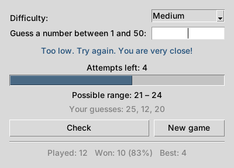

# Random Number Guesser Game

[](https://github.com/CryptGodSon/Easy-Game-Guessing-Game-with-GUI/actions/workflows/ci.yml)


**English** | [Polski](README.pl.md)

A simple number guessing game with a graphical user interface (GUI). Pick a difficulty level and try to guess the secret number before you run out of attempts. Written in Python using only the standard library (`tkinter`) – no extra packages needed.



## Features

- Four difficulty levels:

  | Level  | Range     | Attempts |
  |--------|-----------|----------|
  | Easy   | 1 – 10    | 5        |
  | Medium | 1 – 50    | 7        |
  | Hard   | 1 – 100   | 8        |
  | Expert | 1 – 1000  | 10       |

- "Too low" / "Too high" hints, plus "You are very close!" when you are near
- The possible range shrinks after every guess, so you can play smart
- Input validation – letters, empty input or numbers out of range don't crash the game, and repeating a number doesn't cost an attempt
- Attempts progress bar and list of previous guesses
- Statistics saved between runs: games played, wins, win rate and best score per difficulty
- English and Polish interface (switch it in the **Language** menu)
- Keyboard shortcuts: `Enter` – check, `Ctrl+N` – new game, `Esc` – quit

## Requirements

- Python 3.9 or newer with Tkinter.
  Tkinter ships with the official Python installers for Windows and macOS. On Debian/Ubuntu install it with:

  ```
  sudo apt install python3-tk
  ```

## How to Play

1. Clone or download the repository:

   ```
   git clone https://github.com/CryptGodSon/Easy-Game-Guessing-Game-with-GUI.git
   cd Easy-Game-Guessing-Game-with-GUI
   ```

2. Start the game:

   ```
   python main.py
   ```

   Or install it and run it as a command:

   ```
   pip install .
   guessing-game
   ```

3. Choose a difficulty, type a number and press `Enter` (or click **Check**).
4. Follow the hints until you guess the number – or run out of attempts. Click **New game** (or press `Ctrl+N`) to play again.

Statistics are stored in `~/.guessing_game.json`. You can clear them with **Game → Reset statistics**.

## Project structure

```
main.py              # Tkinter user interface
game.py              # game logic (no GUI, easy to test)
stats.py             # statistics saved between runs
i18n.py              # English and Polish texts
tests/               # unit tests
```

## Development

Run the unit tests:

```
python -m unittest -v
```

Run the linter (also executed by GitHub Actions on every push and pull request):

```
pip install pylint
pylint $(git ls-files '*.py')
```

To add a new language, add an entry to `LANGUAGES` and `TEXTS` in `i18n.py` – the tests check that no text is missing.

See [CHANGELOG.md](CHANGELOG.md) for the list of changes.

## License

This project is licensed under the MIT License - see the [LICENSE](LICENSE) file for details.
