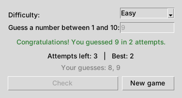

# Random Number Guesser Game

[](https://github.com/CryptGodSon/Easy-Game-Guessing-Game-with-GUI/actions/workflows/pylint.yml)

A simple number guessing game with a graphical user interface (GUI). Pick a difficulty level and try to guess the secret number before you run out of attempts. The game is written in Python and uses only the standard library (`random` and `tkinter`).



## Features

- Three difficulty levels:

  | Level  | Range    | Attempts |
  |--------|----------|----------|
  | Easy   | 1 – 10   | 5        |
  | Medium | 1 – 50   | 7        |
  | Hard   | 1 – 100  | 8        |

- "Too low" / "Too high" hints after every guess
- Input validation – letters, empty input or numbers out of range don't crash the game
- Attempts counter, list of previous guesses and best score per difficulty
- "New game" button – play again without restarting the app
- Keyboard shortcuts: `Enter` checks the guess, `Esc` closes the window

## Requirements

- Python 3.9 or newer with Tkinter.
  Tkinter ships with the official Python installers for Windows and macOS. On Debian/Ubuntu install it with:

  ```
  sudo apt install python3-tk
  ```

## How to Play

1. Clone or download the repository to your local machine.
2. Open a terminal in the project directory.
3. Start the game:

   ```
   python main.py
   ```

4. Choose a difficulty, type a number and press `Enter` (or click **Check**).
5. Follow the hints until you guess the number – or run out of attempts. Click **New game** to play again.

## Project structure

```
game.py              # game logic (no GUI, easy to test)
main.py              # Tkinter user interface
tests/test_game.py   # unit tests for the game logic
```

## Development

Run the unit tests:

```
python -m unittest -v
```

Run the linter (also executed by GitHub Actions on every push and pull request):

```
pip install pylint
pylint $(git ls-files '*.py')
```

## License

This project is licensed under the MIT License - see the [LICENSE](LICENSE) file for details.
