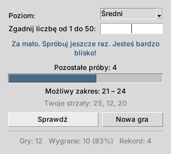

# Zgadnij liczbę – gra z interfejsem graficznym

[](https://github.com/CryptGodSon/Easy-Game-Guessing-Game-with-GUI/actions/workflows/ci.yml)


[English](README.md) | **Polski**

Prosta gra w zgadywanie liczb z interfejsem graficznym. Wybierz poziom trudności i spróbuj odgadnąć wylosowaną liczbę, zanim skończą Ci się próby. Gra jest napisana w Pythonie i korzysta wyłącznie z biblioteki standardowej (`tkinter`) – nie trzeba nic doinstalowywać.



## Funkcje

- Cztery poziomy trudności:

  | Poziom | Zakres    | Próby |
  |--------|-----------|-------|
  | Łatwy  | 1 – 10    | 5     |
  | Średni | 1 – 50    | 7     |
  | Trudny | 1 – 100   | 8     |
  | Ekspert| 1 – 1000  | 10    |

- Podpowiedzi „Za mało” / „Za dużo” oraz „Jesteś bardzo blisko!”
- Możliwy zakres zawęża się po każdym strzale
- Sprawdzanie danych – litery, puste pole i liczby spoza zakresu nie psują gry, a powtórzenie liczby nie zabiera próby
- Pasek pozostałych prób i lista wcześniejszych strzałów
- Statystyki zapisywane między uruchomieniami: liczba gier, wygrane, procent wygranych i rekord dla każdego poziomu
- Interfejs po polsku i po angielsku (menu **Język**; na polskim systemie polski włącza się sam)
- Skróty klawiszowe: `Enter` – sprawdź, `Ctrl+N` – nowa gra, `Esc` – zakończ

## Wymagania

- Python 3.9 lub nowszy z Tkinterem.
  Tkinter jest w oficjalnych instalatorach Pythona dla Windows i macOS. Na Debianie/Ubuntu zainstaluj go poleceniem:

  ```
  sudo apt install python3-tk
  ```

## Jak grać

1. Sklonuj lub pobierz repozytorium:

   ```
   git clone https://github.com/CryptGodSon/Easy-Game-Guessing-Game-with-GUI.git
   cd Easy-Game-Guessing-Game-with-GUI
   ```

2. Uruchom grę:

   ```
   python main.py
   ```

   Albo zainstaluj ją i uruchamiaj jako polecenie:

   ```
   pip install .
   guessing-game
   ```

3. Wybierz poziom, wpisz liczbę i naciśnij `Enter` (albo kliknij **Sprawdź**).
4. Kieruj się podpowiedziami, aż zgadniesz liczbę – albo skończą się próby. Kliknij **Nowa gra** (lub `Ctrl+N`), żeby zagrać ponownie.

Statystyki są zapisywane w pliku `~/.guessing_game.json`. Można je wyczyścić przez **Gra → Wyzeruj statystyki**.

## Struktura projektu

```
main.py              # interfejs graficzny (Tkinter)
game.py              # logika gry (bez GUI, łatwa do testowania)
stats.py             # statystyki zapisywane między uruchomieniami
i18n.py              # teksty po angielsku i po polsku
tests/               # testy jednostkowe
```

## Dla programistów

Uruchomienie testów:

```
python -m unittest -v
```

Uruchomienie lintera (GitHub Actions robi to przy każdym pushu i pull requeście):

```
pip install pylint
pylint $(git ls-files '*.py')
```

Żeby dodać nowy język, dopisz go do `LANGUAGES` i `TEXTS` w pliku `i18n.py` – testy sprawdzą, czy niczego nie brakuje.

Lista zmian: [CHANGELOG.md](CHANGELOG.md).

## Licencja

Projekt jest udostępniony na licencji MIT – szczegóły w pliku [LICENSE](LICENSE).
